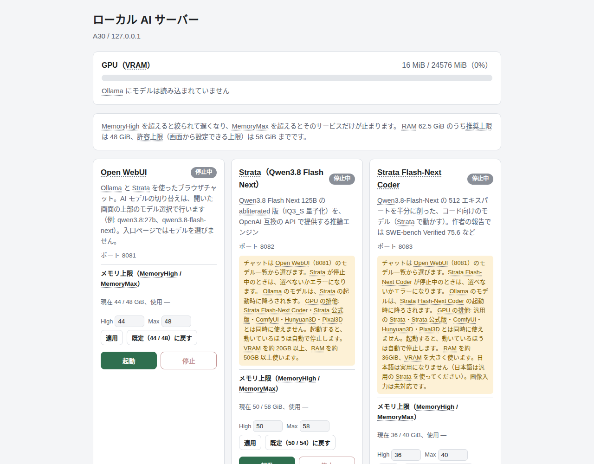
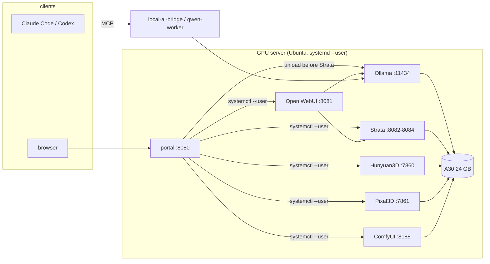
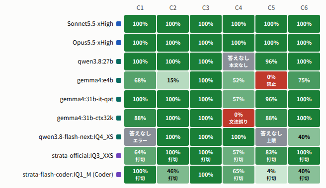

# localai

[](https://github.com/ringo7pie/localai/actions/workflows/ci.yml)
[](LICENSE)

**Running a pack of local AI services on a single 24 GB GPU — and measuring which ones are worth running.**

localai is the glue, ops tooling and evaluation harness behind a personal GPU server (NVIDIA A30, 24 GB):
an LLM server (Ollama), a MoE inference engine that splits experts between CPU and GPU (Strata),
image-to-3D generation (Hunyuan3D, Pixal3D), a ComfyUI watertight-mesh workflow, a bridge that lets Claude Code / Codex
hand mechanical coding work to a local Qwen, and a harness that compares nine models on the same problems.

> 日本語の詳細は [README.ja.md](README.ja.md)。

| | |
|---|---|
| **Portfolio page** | [docs/portfolio.md](docs/portfolio.md) — problems, design decisions, measured numbers |
| **Live reports** | `https://ringo7pie.github.io/localai/` — evaluation reports (Japanese) |
| **Architecture** | [docs/architecture.md](docs/architecture.md) |
| **Requirements** | [docs/hardware-requirements.md](docs/hardware-requirements.md) |



## Highlights

- **GPU arbitration.** One GPU, several heavy services. A small dependency-free web portal starts and stops them,
  stops the other running GPU service before it starts one and unloads the Ollama model before a Strata start; systemd
  `Conflicts=` covers the case where someone calls `systemctl` directly.
- **A MoE model that does not fit in VRAM, served on a 24 GB card.** Strata's engine is built from a pinned commit
  (CUDA 13.2, `sm_80`) and exposed as an OpenAI-compatible API in three variants.
- **An evaluation harness with hidden tests.** Nine models (two Claude, five Ollama, two Strata) answer the same
  16 problems; coding answers run against hidden tests in a sandbox. One finding: the *thinking budget* that looked like a
  handicap for Strata was in fact what kept its score up (45 of 49 runs hit the budget; removing it dropped one variant from
  69 % to 0 %).
- **Reproducible installs.** Upstream projects are pinned to commits, setup scripts are non-interactive, idempotent and
  need no `sudo`; unit files are rendered for wherever you cloned the repo.
- **License-aware publishing.** What may and may not be redistributed was checked against upstream `LICENSE` files —
  see [NOTICE.md](NOTICE.md).

## Architecture



## What is in the box

| Path | What it is | GPU needed |
|---|---|---|
| `localai` | Entry script: `doctor`, `install`, `start` / `stop` / `status`, `test` | no |
| `tools/portal` | Service portal (port 8080): start / stop, GPU exclusion, memory limits. No dependencies | no |
| `tools/strata` | MoE CPU–GPU split inference engine, three model variants (ports 8082–8084) | yes |
| `tools/pixal3d` | Multi-view images → 3D mesh (Pixal3D, port 7861) | yes |
| `tools/hunyuan3d` | Four images → 3D mesh (Hunyuan3D-2mv, port 7860). **Needs license acceptance**, see below | yes |
| `tools/comfyui` | ComfyUI + watertight-mesh workflow (port 8188); native parts built from source | yes |
| `tools/qwen-worker` | MCP server that lets Claude Code / Codex use a local Qwen for read-only research and sandboxed edits | no (calls Ollama) |
| `tools/local-ai-bridge` | Heavier bridge: task ledger, git-worktree isolation, verification, budgets | no (calls Ollama) |
| `tools/model-eval` | Evaluation harness, hidden-test grading, HTML report builders | no (calls servers) |
| `tools/qwen-model-bench` | Measure whether one Ollama model is usable on this machine | yes |
| `tools/status`, `tools/gpu-watch-gui` | What is Qwen doing now / small GTK GPU monitor | no |
| `Documents/` | Evaluation reports and guides (self-contained HTML, Japanese) | — |
| `knowledge/` | Operational notes: measured facts, constraints, decisions (Japanese) | — |

## Quick start

Tested configuration: Ubuntu 24.04, NVIDIA A30 24 GB, driver 595, CUDA 13.2 + 12.6, 64 GB RAM.
Other setups are **unverified** — see [docs/hardware-requirements.md](docs/hardware-requirements.md).

```bash
git clone https://github.com/ringo7pie/localai.git
cd localai
./localai doctor              # checks GPU, CUDA, RAM, disk, uv, Ollama, ports
./localai install ollama      # prints the official Ollama steps and `ollama pull qwen3.8:27b`
./localai install portal      # the web portal (port 8080); no GPU needed
./localai start portal
```

Then add what you need: `./localai install strata`, `pixal3d`, `comfyui`, `hunyuan3d`, `qwen-worker`.
Heavy services are started from the portal (or `./localai start <name>`), one GPU service at a time.

No GPU? You can still read the reports, run the portal and run the unit tests:

```bash
./localai test                # GPU-free tests, reported per tool
python3 tools/portal/portal.py --host 127.0.0.1 --port 18080
```

## Evaluation snapshot (2026-10-08)

Ability = mean score per problem; time = median seconds. Full tables, method and caveats are in the
[report](Documents/AIモデル評価_2026-10-08.html) (Japanese). Few trials per cell — treat small differences as noise.

| Model | 3D math | Coding (6) | Extra (9) |
|---|---|---|---|
| Sonnet 5.5 xHigh | 100 % · 67 s | 100 % · 46 s | 100 % · 2 s |
| Opus 5.5 xHigh | 100 % · 62 s | 100 % · 59 s | 100 % · 3 s |
| qwen3.8:27b (Ollama) | 88 % · 873 s | 83 % · 243 s | 100 % · 13 s |
| gemma4:31b-it-qat | 100 % · 3,660 s | 92 % · 699 s | 100 % · 45 s |
| Strata official IQ3_XXS | 100 % · 839 s | 84 % · 464 s | 98 % · 8 s |
| Strata Coder IQ1_M | 100 % · 728 s | 59 % · 406 s | 89 % · 7 s |



## Security notes

- The portal and the model servers listen on the LAN and have **no authentication**. Anyone on the network can start and
  stop services. Keep them behind a firewall or bind them to `127.0.0.1`.
- One Strata variant is an *abliterated* model (refusal direction removed) and answers harmful requests. If you expose it,
  set `STRATA_API_KEY`.
- Messages that Qwen returns through `qwen-worker` / `local-ai-bridge` (summaries and diffs) travel through the cloud
  parent. This is not a "nothing leaves the machine" setup.

## License and third-party notices

The code and documents in this repository are MIT-licensed ([LICENSE](LICENSE)). Upstream software and model weights are
**not** redistributed; setup scripts fetch them from their sources under their own licenses. See [NOTICE.md](NOTICE.md).

- **Hunyuan3D-2** is under the *Tencent Hunyuan 3D 2.0 Community License*, which does not apply in the EU, UK and
  South Korea. This repository therefore does not ship patches against it, and `tools/hunyuan3d/setup-server.sh`
  asks you to accept the license (`--accept-tencent-license`) before it fetches anything.
- **Pixal3D** output is treated as non-commercial (NVIDIA Source Code License components, Meta DINOv3).
- Product and company names belong to their owners; this project is not affiliated with or endorsed by them.
