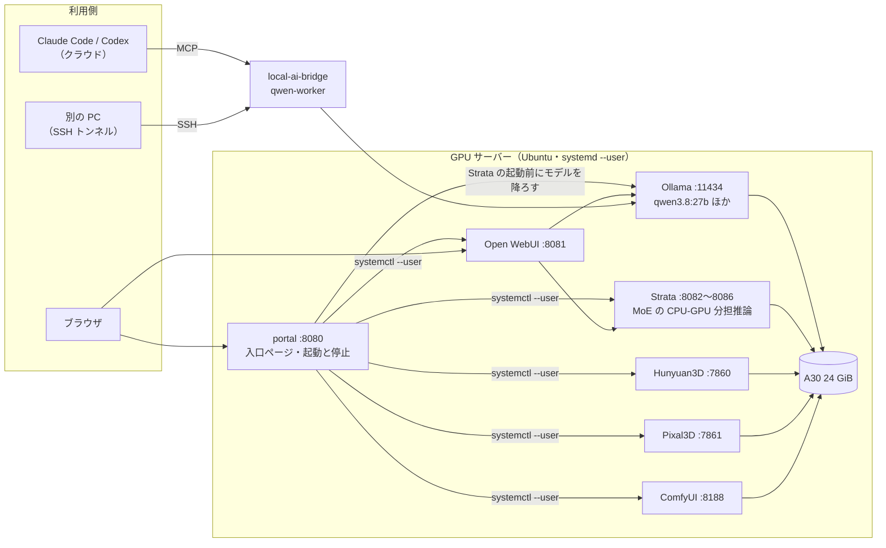
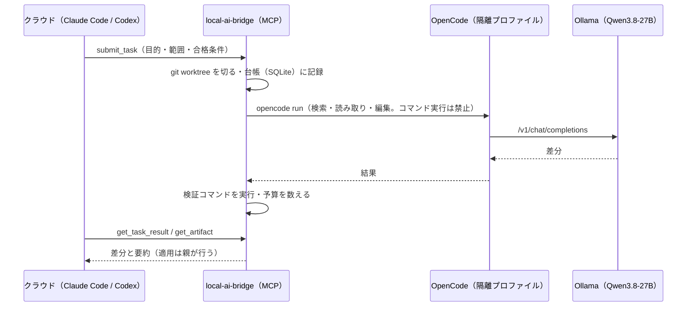
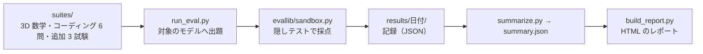

# アーキテクチャ

GPU 1 枚（NVIDIA A30・VRAM 24 GiB）を、複数のローカル AI サービスで取り合いながら使うための構成と、
その上で Claude Code / Codex から実装作業をローカルの Qwen へ回す連携層の設計。
ポートと各ツールの詳細は [README.ja.md](../README.ja.md) と `tools/*/README.md`。

## 1. 全体像

- **GPU を同時に使えるのは 1 つだけ**（Ollama のモデルは VRAM 約 22 GiB、Strata・3D 生成・ComfyUI も重みを載せる）。
  どれかを起動するとき、ほかの GPU サービスを止める責任は入口ページ（portal）にある。Ollama のモデルは Strata の起動前に
  自動で降ろす。3D 生成・ComfyUI を起動する前は、画面の案内に従って Ollama のモデルを降ろす。
- 入口ページ以外のサービスは systemd の user unit で、`enable` しない（自動起動は入口ページだけ）。
  理由は、3D 生成の低 VRAM モードが重みを CPU 側に置いて RAM を使い切り、デスクトップごと固まった経験による。

## 2. GPU の排他（portal）

排他は 2 層で実装している。

| 層 | 仕組み | 効くところ |
|---|---|---|
| 入口ページ（`tools/portal/portal.py`） | 起動の前に、排他の対象を停止し（`GPU_EXCLUSIVE_KEYS`）、Ollama のモデルを降ろす（`OLLAMA_UNLOAD_BEFORE_START_KEYS`）。停止に失敗したら起動しない | 画面・API からの起動 |
| systemd の unit | Strata 5 種は `Conflicts=` で互いを止める。`After=` は一方向の鎖で片側だけに書く（両側に書くと順序が輪になる） | `systemctl --user start` を直に叩いた場合 |

起動・停止の API は `POST /api/service/<key>/<start|stop>`。**`X-Portal-Request: 1` が必須**で、ブラウザの preflight を
強制して、ほかのサイトの JavaScript からの操作を防ぐ。認証は無い（LAN 内の信頼を前提にする。公開するなら `ufw` か
リバースプロキシで守る）。

起動の所要時間は、ディスクキャッシュが冷えていると 4〜5 分（Hunyuan3D を止めた直後の Pixal3D で実測 250 秒。
約 24 GB の重みを読み直す）。ポートが開くまでを「起動中」とする
（systemd の `active` はモデルの読み込み中も真になるため）。

## 3. 推論サーバーの選び方

| サーバー | 役割 | 状況 |
|---|---|---|
| Ollama | 既定の LLM（Qwen3.8-27B Q4_K_M・コンテキスト 65,536 で VRAM 22,201 MiB、生成 23〜26 tok/s） | 常駐。無操作 5 分でモデルを降ろす |
| Strata | MoE の専門家を CPU と GPU に分担させる推論エンジン（OpenAI 互換 API）。VRAM に収まらない大きな MoE を動かす | 汎用版・Coder 版・公式版・公式版 IQ3_S・Swift 1.5 の 5 種（ポートが別、同時には載せない） |
| Hunyuan3D / Pixal3D | 4 枚の画像から 3D メッシュ | 重みと VRAM を食い合うため排他 |
| ComfyUI | 水密なメッシュ（ゲーム用アセット）への変換 | ネイティブ部分（CGAL・CUDA 12.6）を自前でビルド |

Strata の設定は起動のたびに `tools/strata/stra/config.py` の `ModelSpec` と環境変数から作り直される。画面の Settings で
変えた値は次の起動で消える。思考の予算（`STRATA_REASONING_BUDGET_TOKENS`）などは環境変数で変える。

## 4. 連携層（クラウドの Claude Code / Codex → ローカル Qwen）

クラウドを置き換えるのではなく、**実装の探索・編集・テストの反復だけ**をローカルへ移す設計。要求の整理・設計・
タスクの分解・合格条件・レビューと判断はクラウドに残る。

- `local-ai-bridge`: 台帳・worktree 分離・検証・予算を持つ重い連携層（非同期。`submit_task` は受付だけ）。
- `qwen-worker`: ローカル Qwen を直接使う軽い MCP サーバー。調査（読み取り専用）と、隔離された作業コピーでの実装、
  インターネットの検索と取得、構造化出力を持つ。
- **ローカルに閉じない**: Qwen が返した要約と差分は親を通ってクラウドへ送られる。「すべてがローカルだけ」ではない。
- 費用の実測では、委譲しても親のターン数は減らず、クラウドの費用は減らなかった（round 1〜5 で委譲/単独の比は
  0.81〜2.85）。役割は夜間のバッチ・別モデルによるレビュー・ローカルに閉じた作業・他の PC からの利用に絞った。
  根拠は `knowledge/10-silver/areas/local-ai-tools.md`。

## 5. 評価ハーネス（`tools/model-eval`）

- 10 の AI（Claude 2・Ollama 5・Strata 3）のうち、成績が低いとして外した 1 つを除く 9 つを、同じ問題・同じ採点で比べる。
- 標準ライブラリだけで書いてあり、venv を作らない。
- 採点はコードの取り出し・静的な走査・隠しテストの実行。問題ごとに参照解を持ち、解説書の本文は原文と照合して
  食い違えば HTML を作らず止まる。
- 結果の見方は [評価レポート](https://ringo7pie.github.io/localai/reports/AI%E3%83%A2%E3%83%87%E3%83%AB%E8%A9%95%E4%BE%A1_2026-10-08.html) と
  [出題内容の解説書](https://ringo7pie.github.io/localai/reports/AI%E3%83%A2%E3%83%87%E3%83%AB%E8%A9%95%E4%BE%A1_%E5%87%BA%E9%A1%8C%E5%86%85%E5%AE%B9_2026-10-08.html)。

## 6. 設計の判断（要約）

| 判断 | 理由 |
|---|---|
| 排他を portal と systemd の 2 層に置く | 画面からの操作と、`systemctl` を直に叩く操作の両方で GPU の取り合いを防ぐ |
| サービスを `enable` しない | 起動時の RAM・VRAM の枯渇でデスクトップが固まった |
| 設定を起動のたびに作り直す（Strata） | 画面で変えた値が静かに残って、再現できなくなるのを防ぐ |
| 上流を固定コミットで取り込み、直接は直さず `patches/` で当てる | 再実行しても結果が同じ。上流の更新との差が見える |
| setup は非対話・sudo なし・冪等 | 上流の対話式インストーラを置き換え、再実行しても既存物を触らない |
| 評価の問題と採点器を、モデルの記録と一緒に版管理する | 後から同じ条件で再採点・比較できる |
